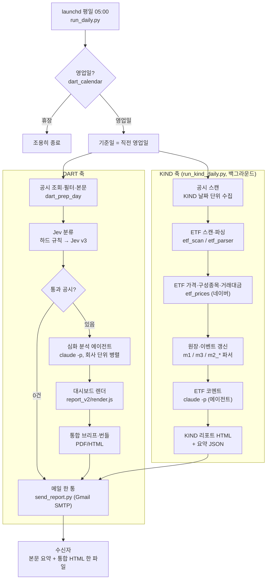

# ipo-llm-approach

KOSPI 상위 종목의 **DART 공시**와 **거래소(KIND) 공시**를 매 영업일 새벽에 자동 분석해, 한 통의 메일로 보내는 일일 리포트 파이프라인입니다.

- **DART 브리프**: 어제 올라온 공시 중 중요한 것만 골라 종목별 한 장짜리 대시보드(HTML/PDF)와 통합 브리프로 정리
- **KIND 리포트**: 지수 주식수가 언제, 얼마나 바뀌는지(권리락·상장·소각 일정)와 자사주 취득, ETF 설정/환매 흐름
- 정보 제공용 자동 생성 문서이며 투자 권유가 아닙니다.

> 이어서 개발하는 분은 [`docs/HANDOFF.md`](docs/HANDOFF.md)(DART 축)와 [`docs/KIND_HANDOFF.md`](docs/KIND_HANDOFF.md)(KIND 축)를 먼저 읽으세요.

## 목차
1. [받는 사람을 위한 안내](#1-받는-사람을-위한-안내)
2. [일일 운영 흐름](#2-일일-운영-흐름)
3. [실행과 설정](#3-실행과-설정)
4. [레포 지도](#4-레포-지도)
5. [알려진 한계](#5-알려진-한계)

---

## 1. 받는 사람을 위한 안내

### 언제, 무엇을 받나
평일(영업일) **오전 5시경**, 직전 영업일 기준으로 메일이 한 통 옵니다. 제목은 `[AI Agent 공시 브리핑] 날짜`입니다. 중요한 DART 공시가 없는 날은 제목에 "DART 중요 공시 없음"이 붙고 KIND 내용만 옵니다. 휴장일에는 오지 않습니다.

| 위치 | 내용 |
|---|---|
| 메일 본문 위쪽 | DART 브리프: 중요도 상위 공시와 한 줄 요약 표 |
| 메일 본문 중간 | KIND · 지수 주식수 변동: 신규 이벤트, 5영업일 내 일정, 시총 변동 상위 |
| 메일 본문 아래 | KIND · ETF 설정/환매 흐름: 시황 코멘트 3줄 |
| 첨부 | 통합 리포트(HTML 한 파일, 제목 "AI Agent 기반 공시분석"): 처음 열리는 탭은 DART 공시분석(당일)이고, 앞 두 탭이 DART, 이어서 KIND 탭들. 아래 탭 구성 |

### 통합 리포트 탭
**DART 공시분석(당일)**은 기준일 심화 분석 공시를 중요도 순 목록과 종목별 상세(KPI·핵심 포인트·3년 실적·가치평가·컨센서스·뉴스)로 보여 줍니다. **주요 공시 모아보기**는 최근 7일 심화 분석 공시 중 중요도 상위 15건을 공시일과 함께 모아 보여 주며, DART 공시분석(당일) 바로 옆 탭입니다. 나머지는 KIND 탭입니다.

| 탭 | 보는 법 |
|---|---|
| 예정 CA(확정) | 권리락·신주 상장·변경상장일이 정해진 건(일정 확정). 지수 반영일이 빠른 순. 왼쪽에서 고르면 상세(★ = 지수 주식수에 직접 영향) |
| 예정 CA(미확정) | 변경상장 공시 전 건(일정 미확정). 기본은 예정일(추정)이 빠른 순, 시총 변동·변동 비율 순으로 바꿀 수 있음 |
| 자사주 취득 | 취득 중인 종목의 진행률, 남은 금액, 예상 소진일 |
| ETF 흐름 | 국내 ETF 설정/환매로 본 자금 흐름. 1일 · 7일 · 3개월 전환 |
| 반영된 CA | 신주·변경상장이 끝나 지수에 반영된 지 일주일 이내인 건 |

CA(Corporate Action)는 유·무상증자, 자기주식 소각, CB/BW 전환, 분할·합병처럼 주식수가 바뀌는 기업 행위를 뜻합니다. 예정 CA는 아직 지수에 반영되지 않은 건, 반영된 CA는 반영이 끝난 건입니다.

> DART 탭들은 DART 산출물(`trial_case/<기준일>/reports`)이 모두 나온 뒤 `kind/html_report.py <날짜> --dart-day <기준일>`로 합쳐 만듭니다. KIND 쪽이 실패한 날에만 DART 번들(HTML·PDF)을 첨부합니다.

**ETF 흐름 탭**은 시장 코멘트, 시장대표·레버리지·인버스 순유입, 순유입/유출 상위 ETF, 테마별 합계, 신규 ETF, 그리고 ETF 구성 비중으로 추정한 **종목별 매수·매도 압력**을 보여줍니다. 압력 표 아래의 "하루 거래대금 대비"는 압력을 최근 5영업일 평균 거래대금으로 나눈 값으로, +0.50일이면 하루 거래대금의 절반만큼 사들이는 힘이라는 뜻입니다.

### 용어 한 줄
- **지수 주식수**: 지수(KOSPI200 등)가 반영하는 상장주식수. 늘거나 줄면 지수 추종 자금이 사고팔게 됩니다.
- **권리락일 / 변경상장일 / 신규상장일**: 주주배정 유상증자·무상증자는 권리락일, 자기주식 소각은 변경상장일, 제3자배정·CB 전환 등은 신주 상장일에 지수 주식수가 바뀝니다.
- **순유입**: ETF 설정(+)에서 환매(−)를 뺀 좌수에 설정일 종가를 곱한 금액입니다.

### 읽을 때 주의
- 시총 변동은 기준일 종가 × 변동 주식수의 **추정치**입니다(유동비율 미적용).
- ETF 금액은 종가 기준 근사이며, 3개월 값은 외부 집계와 10~30% 차이가 날 수 있습니다. 채권·머니마켓·해외 ETF는 제외합니다.
- 시장 코멘트는 AI가 집계 수치만 사용해 작성하며, 해석은 참고용입니다.

---

## 2. 일일 운영 흐름

launchd가 평일 05:00에 `run_daily.py`를 실행합니다. 한 번의 실행에서 **KIND 축(백그라운드)** 과 **DART 축**이 병렬로 돌고, 마지막에 하나의 메일로 합쳐집니다.



### DART 축 단계
1. **수집·필터** (`dart_prep_day.py`): 전일 공시 전체를 OpenDART로 조회 → 대상 종목 명단(`kospi_list_clean.md`, KOSPI 시총 상위) 필터 → 제목 규칙 필터(`dart_rules.py`) → 자회사 중복 제거 → 영구채 CB/BW 이중 신고 제거(`자본으로인정되는채무증권발행결정`이 같은 사채의 CB/BW 발행결정과 내용이 같으면 CB/BW 1건만 남김)(`dart_subsidiary.py`) → 원문 수집(`dart_body.py`). DART 점검으로 본문이 비면 10분 간격으로 최대 6회 재시도.
2. **분류 (Jev 사용)** (`jev_test/triage_day.py`): 각 공시가 심화 분석할 만큼 중요한지 **Jev(TypeSafe System One 모델)** 로 판정합니다. 먼저 하드 규칙(`rules_core.py`)으로 확정되는 건(정정, 단순 형식 등)은 모델 호출 없이 처리하고, 나머지는 Jev v3에 질문을 던져 확률로 PASS / PASS_CHECK / HOLD / NOTIFY / DROP 라벨을 붙입니다(시총 구간별 임계값). 실제 운영 로그 기준 2026-10-08은 7건 전부, 10-07은 14건 중 12건이 Jev 판정이었습니다. 키는 `.env`의 `TYPE_SAFE_AI_KEY`. 상세: [`docs/DISCLOSURE_TRIAGE.md`](docs/DISCLOSURE_TRIAGE.md).
3. **심화 분석** (`run_daily.py` → `claude -p --model sonnet`): 통과 공시 최대 30건을 회사 단위(공시 3건씩)로 묶어 4개 에이전트가 병렬로 처리. 재무·가치평가·컨센서스·수주(OpenProxyMCP)와 뉴스를 조회해 대시보드 JSON을 작성합니다. 지침은 [`report_v2/AGENT_SPEC.md`](report_v2/AGENT_SPEC.md)(기준일 이후 데이터 혼입 금지 등). 결과가 빠진 회사는 1회 재실행.
4. **렌더·번들** (`report_v2/render.js`, `render_bundle.js`): 공시 1건당 A4 한 장 HTML/PDF와 인덱싱용 MD(`disclosure_md/`), 하루치 통합 번들.

### KIND 축 단계
1. **수집**: KIND 날짜 단위 스캔으로 이벤트성 공시(유무상증자, 소각, 분할·합병, CB/BW 등)와 시장조치를 DB(`kind/data/kind.db`)에 적재. 인적분할 신설법인·합병 소멸회사는 자동 등록 후 추적.
2. **ETF**: 전체 ETF 수량변경 일괄공시를 날짜 단위로 스캔·파싱(운용사 약 19곳) → 네이버에서 종가·분류·상위10 구성종목·종목별 5일 거래대금 수집.
3. **원장·이벤트**: 주식수 원장과 이벤트 스레드(유상증자·소각·CB/BW·분할·합병)를 규칙(`docs/KIND_INDEX_METHOD.md`)대로 갱신해 지수 반영일을 계산.
4. **ETF 코멘트**: 집계 JSON만 입력으로 `claude -p`가 시황 코멘트를 작성. 근거 없는 숫자나 금지 표현이 있으면 재시도 후 자동 템플릿으로 대체.
5. **리포트**: `ai-disclosure-report_<날짜>.html` + 메일용 요약 JSON. ETF 쪽 오류는 해당 탭만 빠지고 나머지는 나갑니다.

### 안전장치
- DART 단계가 실패해도 이번 실행의 KIND 리포트 HTML이 있으면 메일은 나갑니다(제목에 "DART 처리 오류", 본문 비고에 사유). HTML이 없으면 알림 메일만 갑니다.
- KIND 실패는 DART를 막지 않고, ETF 실패는 KIND 리포트를 막지 않습니다(각 단계 경고만 기록).
- 실패하면 알림 메일 + macOS 알림. 같은 기준일은 `state/sent_<날짜>`로 중복 발송을 막습니다(`--force`로 재실행).
- 휴장일 목록(`dart_calendar.py`)이 범위를 벗어나면 경고. KIND 방화벽 차단이 감지되면 이후 온라인 단계를 건너뜁니다.

---

## 3. 실행과 설정

### 준비
```bash
uv venv --python 3.12 .venv && uv pip install --python .venv/bin/python requests pypdf
npm i playwright && npx playwright install chromium   # 렌더러(PDF 변환)
```
`.env`(git 제외)에 `DART_API_KEY`, `TYPE_SAFE_AI_KEY`, `GMAIL_USER`, `GMAIL_APP_PASSWORD`(선택: `MAIL_TO`)를 둡니다. 정규 수신자 명단은 `EXTRA_TO`(쉼표로 구분)에 두며, 이 값은 `.env`에만 있고 레포에는 올리지 않습니다. 에이전트 단계는 `claude` CLI 로그인과 OpenProxyMCP 연결이 필요합니다. 리포트 메일에는 `EXTRA_TO`의 수신인이 항상 포함됩니다(`--test` 메일은 본인에게만 갑니다).

### 자동 실행 (launchd)
`ops/com.sentineldart.daily.plist`를 `~/Library/LaunchAgents/`에 복사해 등록합니다(평일 05:00). 맥이 잠자기 상태면 깨어날 때 실행됩니다.

### 수동 실행
```bash
.venv/bin/python run_daily.py                       # 오늘이 영업일이면 직전 영업일 기준 전체 실행(메일 발송)
.venv/bin/python run_daily.py --date 20261008 --with-kind --reuse-dart --force   # 스모크: DART는 기존 산출물 재사용, KIND·ETF·메일은 실제 실행
.venv/bin/python run_daily.py --no-send             # 메일만 생략
.venv/bin/python kind/run_kind_daily.py --asof 2026-10-08   # KIND 축만
.venv/bin/python kind/html_report.py 2026-10-08     # KIND 리포트만 다시 만들기
```
스모크 테스트 뒤에는 `state/sent_<날짜>`를 지워야 같은 기준일의 정규 실행이 막히지 않습니다. KIND DB를 처음부터 다시 만들 때는 `kind/rebuild_all.sh`(일일 작업 중에는 거부됨).

---

## 4. 레포 지도
| 경로 | 내용 |
|---|---|
| `run_daily.py` · `send_report.py` · `kind_hook.py` · `ops/` | 일일 무인 실행 · 메일 · KIND 훅 · launchd 설정 |
| `dart_*.py` · `judge_rules.md` | DART 축: 수집·규칙 필터·자회사/CB·BW 중복 제거·본문·휴장일 |
| `jev_test/` | Jev 분류(하드 규칙 + Jev v3)와 평가·라벨링 도구 → [`jev_test/README.md`](jev_test/README.md) |
| `report_v2/` | 대시보드 에이전트 지침과 HTML/PDF 렌더러 |
| `kind/` | KIND 축: 수집·원장·이벤트·ETF·리포트 → [`kind/README.md`](kind/README.md) |
| `trial_case/` · `disclosure_md/` | 일자별 DART 산출물 · 인덱싱용 MD |
| `docs/` | 인수인계·설계 문서: `HANDOFF.md`, `DISCLOSURE_TRIAGE.md`, `KIND_HANDOFF.md`, `KIND_DESIGN.md`, `KIND_INDEX_METHOD.md`, `KIND_ETF_PLAN.md` |
| `dep/` | 더 이상 쓰지 않는 파일 보관(삭제 아님) |

---

## 5. 알려진 한계
- 대상은 KOSPI 시총 상위 종목 명단(DART 약 290, KIND 약 300)이며, 우선주·우리사주·일반공모 등은 리포트 화면에서 뺍니다.
- DART 심화 분석은 하루 최대 30건까지 투입합니다(비용 상한). 초과분은 메일 비고에 표시됩니다.
- ETF 구성종목은 최신 비중 기준이고 상위 10종목만 반영합니다. 테마 분류는 이름 키워드와 네이버 분류에 의존하므로 보정이 계속 필요합니다.
- 과거 날짜로 KIND 리포트를 다시 만들면 그 이후 공시가 섞일 수 있습니다(일일 운영에서는 해당 없음).
- API 키는 `.env`에만 두고 커밋하지 않습니다(레포가 public).
